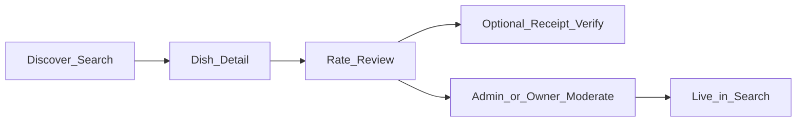
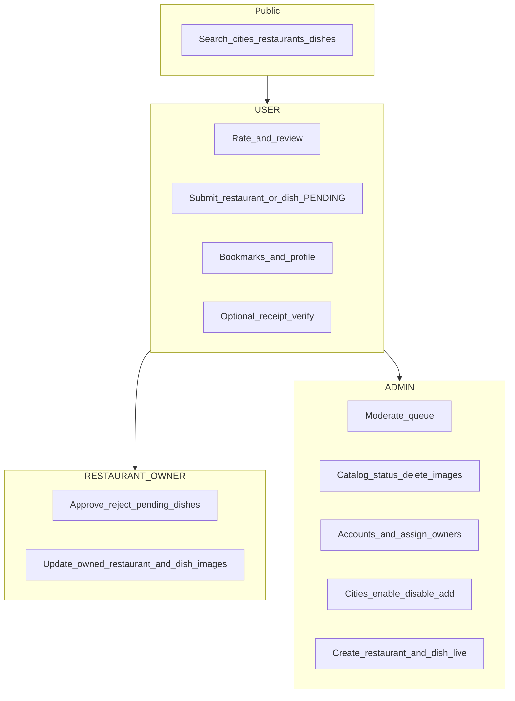
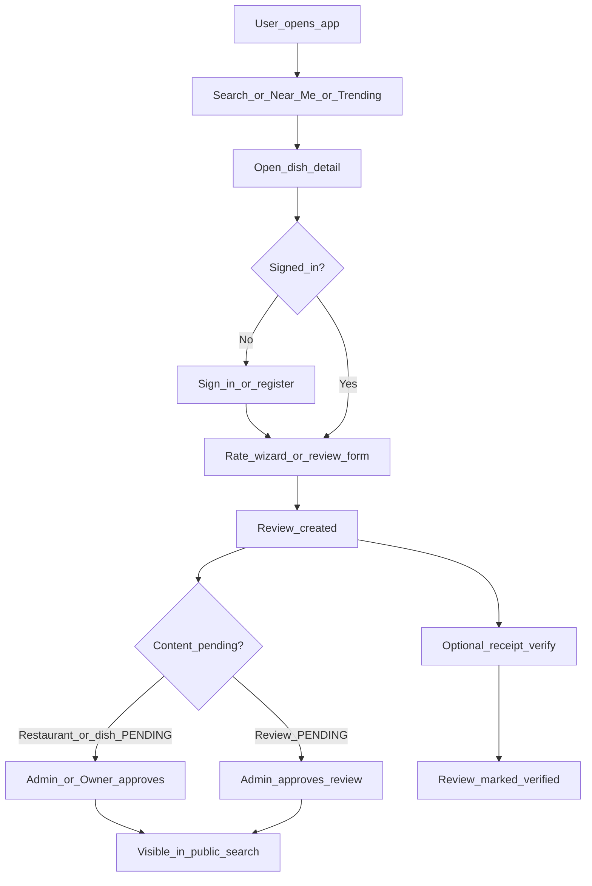
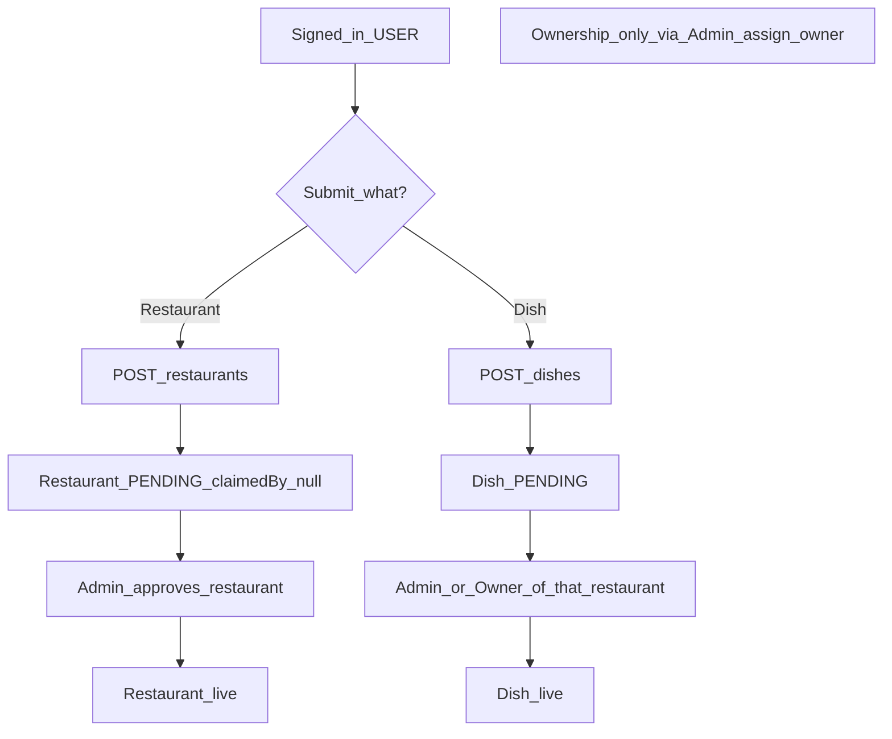
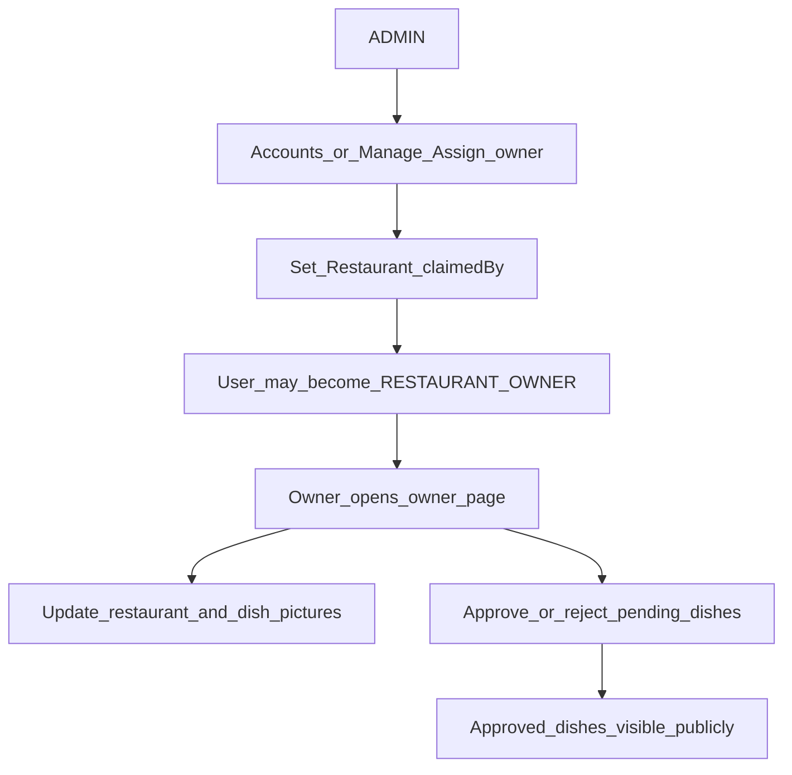
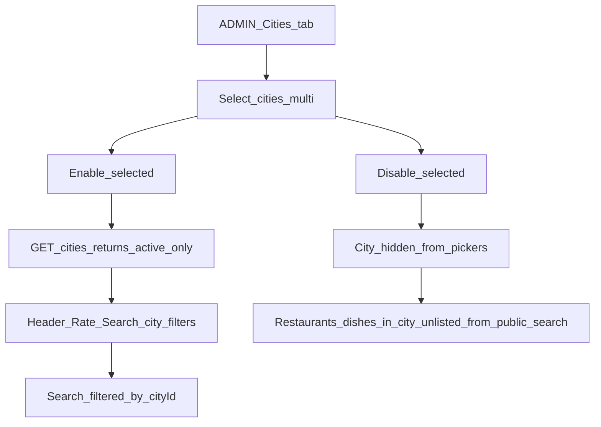
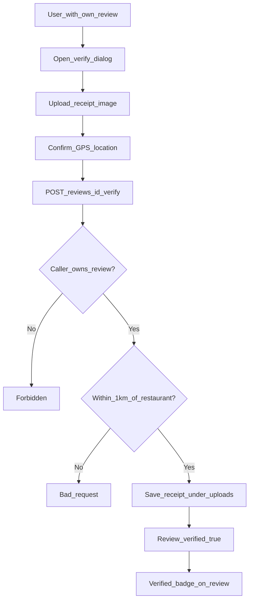
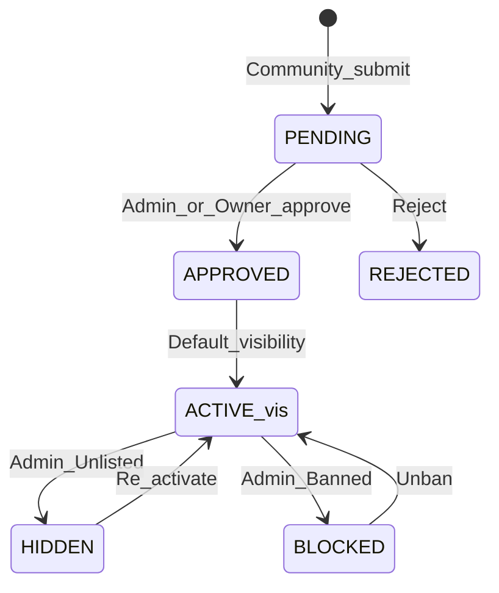

# DishRank Feature Audit

**Document date:** 28 July 2026  
**Scope:** Monorepo MVP — NestJS API (`apps/api`), Next.js web (`apps/web`), shared types (`packages/shared`)  
**Purpose:** Inventory of completed features, roles, remaining work, improvement priorities, and end-to-end product flows.

---

## 1. Are we on the right path?

**Yes — for an MVP dish-ranking portal.**

The product thesis is clear: users discover and rate **dishes** (not only restaurants), with optional receipt verification, city-scoped discovery, and a moderation model that separates **community submit** from **restaurant ownership**.

Architecture matches that thesis:

| Layer | Choice | Fit |
|-------|--------|-----|
| API | NestJS + Prisma + PostgreSQL | Solid for auth, roles, moderation queues |
| Web | Next.js App Router | Search, rate wizard, admin/owner panels |
| Shared | `@dishrank/shared` types | Keeps roles/status enums aligned |
| Auth | JWT + role / ownership checks | Enough for MVP; needs hardening for production |

**Core loop is real end-to-end** (not a mock-only demo):

**Main risks going forward** are growth/polish, not foundation:

- Production JWT secret and deploy hardening
- Post-MVP: notifications, analytics, rich maps, claims portal, i18n
- Dish submit still allows any authenticated user to suggest dishes on any live restaurant (by design for community; owners moderate)

**Recently closed gaps (Jul 2026):** real profile reviews / related dishes / popular searches; seed enables Karachi–Lahore–Islamabad + owner account; owner `RolesGuard`; verify requires ownership + GPS ≤1 km; image file upload; refresh token endpoint; no silent mock fallbacks when API is live.

---

## 2. Roles and functionality

Three roles exist in Prisma / shared types: `USER`, `RESTAURANT_OWNER`, `ADMIN`.

### Role matrix

| Role | How assigned | Can do | Cannot do |
|------|--------------|--------|-----------|
| **USER** | Default on register | Search; rate; submit restaurant/dish (pending); bookmarks; profile; review + optional verify | Admin panel; manage restaurants unless later assigned as owner |
| **RESTAURANT_OWNER** | Admin assigns ownership (`Restaurant.claimedBy`); may auto-promote from USER | `/owner`: approve/reject pending dishes on owned venues; set restaurant/dish image URLs | Platform moderate queue; city/user admin; create restaurants that auto-claim ownership |
| **ADMIN** | Seed account or Accounts tab | Full catalog, moderate queue, accounts, cities, create restaurant/dish, assign owners, images, hide/ban/delete | — |

### Auth model (summary)

- **Register** always creates `USER` (no self-serve role picker).
- **Login** blocks `BANNED` / `DEACTIVATED` users.
- **Admin** routes: JWT + `AdminGuard` (`role === ADMIN`).
- **Owner** routes: JWT + `RolesGuard` (`RESTAURANT_OWNER` or `ADMIN`) + service checks that `Restaurant.claimedBy === userId`.
- **Community submit ≠ ownership** — `claimedBy` stays null until admin assigns a restaurant contact.
- **Refresh:** `POST /auth/refresh` with stored refresh token.

### Seed credentials (local)

| Email | Password | Role |
|-------|----------|------|
| `admin@dishrank.com` | `password123` | ADMIN |
| `demo@dishrank.com` | `password123` | USER |
| `owner@dishrank.com` | `password123` | RESTAURANT_OWNER (owns Student Biryani) |

Seed also **enables** Karachi, Lahore, and Islamabad so city pickers work out of the box.

### Role capability swimlane

---

## 3. Completed features

### 3.1 Public / USER

| Feature | Notes |
|---------|--------|
| Home + search | Dish/restaurant type, sort, min rating, city filter; **popular searches from API** |
| Near Me | GPS-based discovery |
| Dish detail | Ratings, reviews, save, rate CTA, verify; **related dishes from API** |
| Restaurant detail | Address, dishes, restaurant image when set |
| Trending | Home trending dishes from API |
| Auth | Register, login, logout → home, profile edit; **refresh token** |
| Rate wizard | Category → dish (find/add) → city → restaurant → review |
| Bookmarks | API toggle; Profile Saved; `/saved` |
| Profile My Reviews | **`GET /reviews/me`** (real data) |
| Community submit | Restaurant/dish → `PENDING`; submitter is **not** owner |
| Review verify | Receipt upload; **must own review**; **GPS within 1 km** of restaurant |

**Key routes:** `/`, `/search`, `/near-me`, `/rate`, `/profile`, `/saved`, `/add-dish`, `/dishes/[id]`, `/restaurants/[id]`

### 3.2 ADMIN (`/admin`)

| Tab | Capability |
|-----|------------|
| **Manage** | Catalog: Active / Unlisted / Banned; delete; assign owner; pictures (**URL or file upload**) |
| **Add Restaurant** | Create approved restaurant (city, lat/lng, optional image) + optional dish drafts |
| **Add Dish** | Add approved dish to existing restaurant (optional image URL) |
| **Moderate** | Approve/reject pending restaurants, dishes, reviews |
| **Accounts** | List/create/edit users; role; password; ban/deactivate; assign owned restaurants |
| **Cities** | List; province filter; multi-select enable/disable; add city |

### 3.3 RESTAURANT_OWNER (`/owner`)

| Tab / area | Capability |
|------------|------------|
| **Pictures** | Update images via **file upload** or URL for owned restaurants/dishes |
| **Pending dishes** | Approve/reject user-submitted dishes for owned venues |

### 3.4 Platform / data model

- **City** table with `isActive` (default **false**); public list = active only; disabled cities unlisted from search
- **ContentStatus** (`ACTIVE` / `HIDDEN` / `BLOCKED`) on restaurants & dish visibility
- **ApprovalStatus** (`PENDING` / `APPROVED` / `REJECTED`) on restaurants, dishes, reviews
- **UserStatus** (`ACTIVE` / `DEACTIVATED` / `BANNED`)
- Indexes on status/visibility/city for scale-friendly queries
- Shared enums/types in `packages/shared`

### 3.5 API surface (high level)

| Area | Examples |
|------|----------|
| Auth | `POST /auth/register`, `POST /auth/login`, `POST /auth/refresh`, `PATCH /auth/me` |
| Public read | `GET /cities`, `GET /restaurants`, `GET /dishes/:id`, `GET /dishes/:id/related`, `GET /dishes/trending`, `GET /search`, `GET /search/popular` |
| User write | `POST /restaurants`, `POST /dishes`, reviews, verify, bookmarks, `GET /reviews/me` |
| Media | `POST /media/upload` (ADMIN / RESTAURANT_OWNER) |
| Owner | restaurants, pending dishes, approve/reject, image patches |
| Admin | pending, catalog, users, cities, create, status, images, owner assign, approve/reject, delete |

---

## 4. Remaining / incomplete

### 4.1 Post-MVP product gaps

| Gap | Impact |
|-----|--------|
| Notifications | Users not alerted when dishes approved / reviews replied |
| Analytics dashboard | No admin metrics beyond pending queues |
| Rich map UI | Near-me is list-based only |
| Formal claims portal | Ownership still admin-assigned offline |
| i18n | English-only UI |
| Community dish submit policy | Any signed-in user can suggest dishes on any live restaurant (owners still moderate) |

### 4.2 Hardening (production)

- Set a strong production `JWT_SECRET` (avoid default `dishrank-dev-secret`)
- Document env vars for deploy (`DATABASE_URL`, `NEXT_PUBLIC_API_URL`, etc.)
- Optional: rate-limit auth and upload endpoints

---

## 5. What to improve next (prioritized)

1. **Production deploy checklist** — secrets, HTTPS, CORS origins, health checks.
2. **Notifications** — email or in-app when pending content is approved/rejected.
3. **Analytics** — simple admin counts (reviews/week, top cities, pending aging).
4. **Map view** for Near Me (optional).
5. **Claims self-serve** only if venues need to request ownership without admin chat.

---

## 6. Product flows

### 6.1 Discovery → rate → moderate → live

### 6.2 Community submit (not ownership)

### 6.3 Admin assigns owner → owner workflow

### 6.4 City enable / disable → public portal

### 6.5 Review verification (receipt)

Verification enforces **review ownership** and **GPS proximity** (≤ 1 km).

### 6.6 Status model (content lifecycle)

---

## 7. Web routes map

| Route | Audience | Purpose |
|-------|----------|---------|
| `/` | Public | Home, trending, search entry |
| `/search` | Public | Full search + filters |
| `/near-me` | Public | Location-based results |
| `/rate` | USER+ | Multi-step rate wizard |
| `/add-dish` | USER+ | Suggest dish |
| `/dishes/[id]` | Public | Dish detail + reviews |
| `/restaurants/[id]` | Public | Restaurant detail |
| `/profile` | USER+ | Profile, saved, account; redirects home if logged out |
| `/saved` | USER+ | Saved dishes |
| `/admin` | ADMIN | Full admin panel |
| `/owner` | Owner (claimedBy) | Pictures + pending dish moderation |

---

## 8. Verdict

DishRank’s MVP loop is **complete and demoable out of the box** after seed: dish-first ranking, city gating, pending moderation, admin-assigned ownership, real profile reviews, related dishes, popular searches, image upload, and hardened verify.

Next value is **production hardening** and optional growth features (notifications, analytics, maps) — not more foundation rewrites.

---

## Appendix A — Demo checklist

1. Start Postgres + API + web (`docker compose` / `npm run setup:db` / `npm run dev`).
2. Run seed if needed: `cd apps/api && npm run prisma:seed`.
3. Sign in as `admin@dishrank.com` / `password123` — Admin panel.
4. Sign in as `owner@dishrank.com` / `password123` — `/owner` pictures + pending dishes (Student Biryani).
5. Sign in as `demo@dishrank.com` / `password123` — search, rate, save, verify (near restaurant GPS).
6. Cities Karachi / Lahore / Islamabad should already appear in pickers.

## Appendix B — Document generation

Source of truth: this file (`docs/FEATURE_AUDIT.md`).  
Downloadable PDF: `docs/DishRank-Feature-Audit.pdf` (generate with `npm run docs:pdf`).
